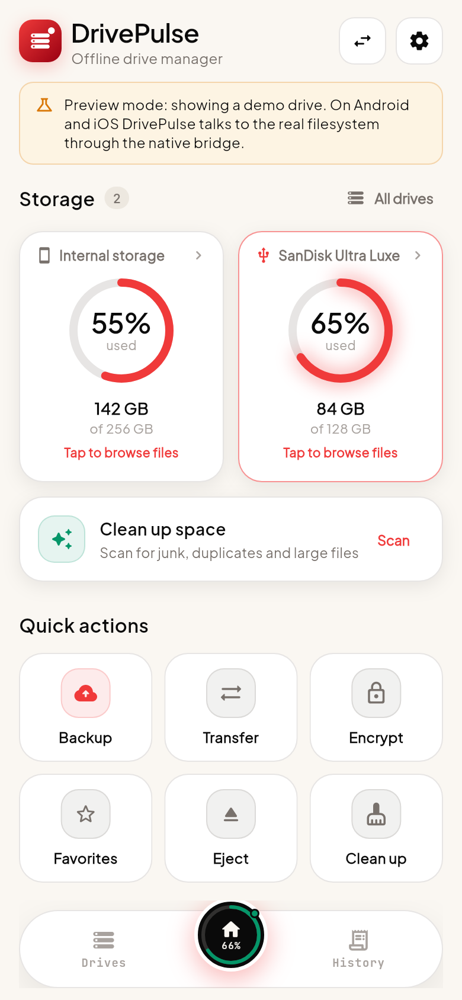
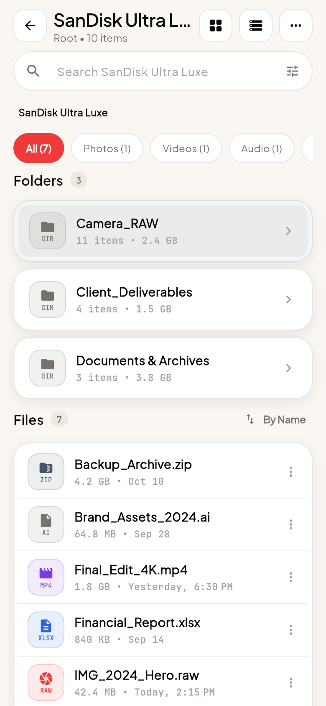
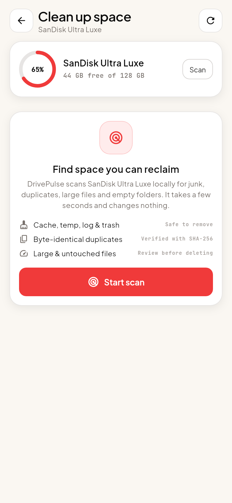
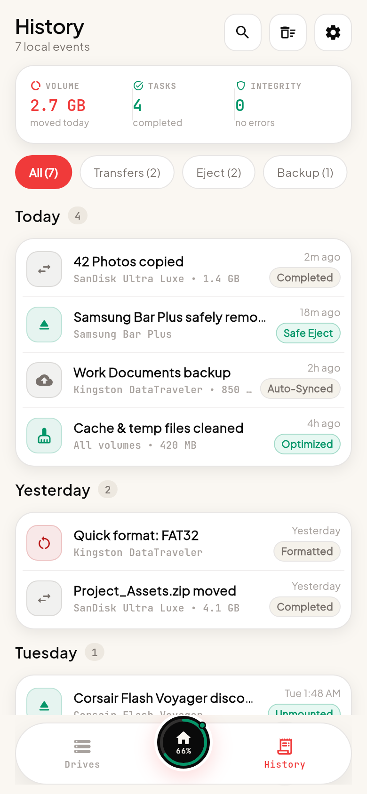
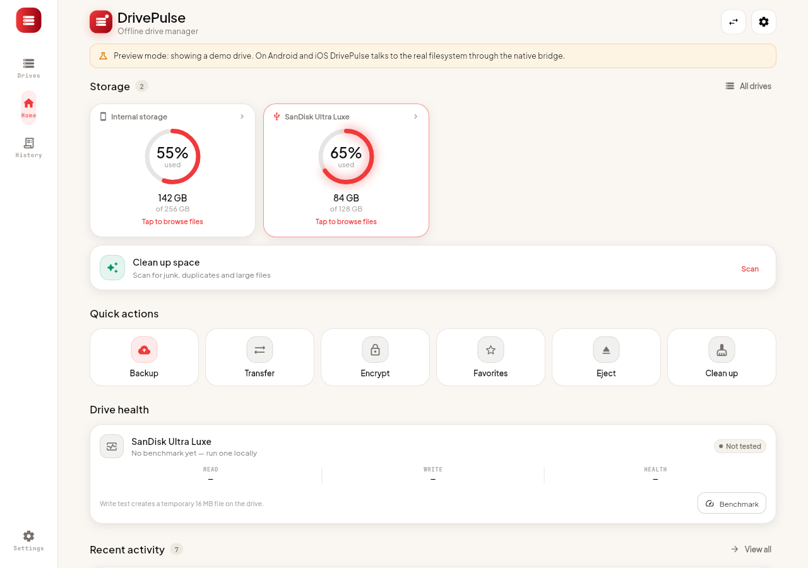

# DrivePulse

**Offline external-drive manager for Android and iOS.** Browse, copy, verify, encrypt, benchmark and clean up USB drives, SD cards and external SSDs — with no account, no cloud and no network permission in the release build.

Built with Flutter (presentation + local domain logic) and real native platform channels (Kotlin on Android, Swift on iOS) for filesystem access.

---

## Why it exists

Phone storage is finite; the drive in your pocket is not. But managing a USB-C stick on a phone usually means a cloud app that wants an account, uploads filenames and gives you a five-file limit. DrivePulse takes the opposite position:

- **No sign-in.** There is no user model.
- **No server.** The Android release manifest has no `INTERNET` permission at all.
- **No analytics.** No SDK, no device fingerprint, no crash phone-home.
- **No fake capabilities.** Android scoped storage, SAF and iOS folder authorisation are handled honestly, and the UI explains what the OS does not allow.

## Feature set

| Area | What you get |
| --- | --- |
| Drive dashboard | Radial capacity gauges, live transfer banner, quick actions, health summary, recent activity |
| Drive discovery | Internal storage, USB/OTG volumes via `StorageManager`, SD cards, remembered drives with last-seen capacity |
| File browser | Breadcrumb navigation, list/grid views, recursive search, category filters, sorting, multi-select, hidden files |
| File operations | Copy, move, rename, delete, new folder, open, share, favourites, file details |
| Transfers | Sequential queue with byte progress, pause/resume (file boundary), cancel, ETA, per-job history |
| Backup | One-tap folder backup to a second connected drive |
| Storage analyzer | Category breakdown, junk/temp detection, SHA-256 duplicate groups, large files, empty folders, 180-day stale files |
| Health | Local 8 MB sequential read/write benchmark, capacity-pressure-aware health estimate, clear "not S.M.A.R.T." labelling |
| Vault | AES-256-GCM file encryption with PBKDF2-HMAC-SHA256 (120,000 rounds); passphrase never stored |
| History | Local, filterable, day-grouped activity log capped at 400 events |
| Settings | Light/dark/system theme, grid or list, sort defaults, thresholds, haptics, in-app alerts, privacy explainer, licences |
| Accessibility | Text-scale clamping, semantic labels on gauges and controls, 48 dp targets, high-contrast dark theme |

The UI follows the provided Stitch **DrivePulse / Kinetic Drive Precision** design system: warm cream canvas, obsidian instrument panels, signal-red telemetry, Plus Jakarta Sans for interface and JetBrains Mono for every number.

## Screens

- Onboarding (three-slide offline promise)
- Dashboard — storage gauges, active transfer, six quick actions, health, activity
- Drives — current drive, also-connected drives, remembered drives, connection guidance
- Drive details — dark telemetry panel, benchmark, category breakdown, specs, eject/format guidance
- Browse — folders, files, breadcrumbs, filters, recursive search, multi-select, destination picker
- Clean up — reclaimable hero, categorised breakdown, duplicates review, junk, large files, stale files
- Transfers — in-progress panel, queue and finished jobs
- Vault — encrypted-file discovery, encryption and decryption
- Favourites — pinned paths with resilient re-resolution
- History — filters, today telemetry, day groups, event sheets
- Settings — appearance, library, alerts, privacy, device, about

## Screenshots

<table>
  <tr>
    <td></td>
    <td></td>
    <td></td>
    <td></td>
  </tr>
  <tr>
    <td align="center"><sub>Dashboard</sub></td>
    <td align="center"><sub>File browser</sub></td>
    <td align="center"><sub>Clean up</sub></td>
    <td align="center"><sub>History</sub></td>
  </tr>
</table>



The wide layout switches to a side rail and a multi-column instrument grid; the dark theme is a first-class variant, not an afterthought.

## Offline guarantees (verifiable)

1. `android/app/src/main/AndroidManifest.xml` contains **no** `android.permission.INTERNET`.
2. The only network-adjacent code is the operating system's own document picker.
3. Activity history is a JSON file in the app support directory (SharedPreferences on web preview).
4. Vault passphrases never leave the encryption call frame; only the derived key exists transiently.
5. There is no analytics dependency in `pubspec.yaml`.

`test/offline_guarantee_test.dart` asserts the first point on every test run.

## Architecture

```
lib/
├── core/
│   ├── theme/        colours, type ramp (variable fonts), Material 3 theme
│   ├── utils/        byte formatting, date grouping, file-kind mapping
│   └── widgets/      cards, radial gauge, pills, file rows, sheets, dialogs, nav shell
├── data/
│   ├── models/       Volume, FileEntry, TransferTask, ActivityEvent, breakdowns, health
│   ├── services/     native bridge, demo backend, analyzer, encryption, transfer queue,
│   │                 settings store, activity store
│   └── state/        AppState (single ChangeNotifier above the navigator)
└── features/
    ├── onboarding/   three-slide offline promise
    ├── shell/        three-tab shell + floating/side navigation
    ├── dashboard/    storage cards, quick actions, health, activity preview
    ├── drives/       drive list + drive details + benchmark + specs
    ├── browse/       file browser + favourites
    ├── cleanup/      analyzer results and safe cleanup flows
    ├── transfers/    queue and history
    ├── vault/        encrypted-file discovery and decryption
    ├── history/      filters, summary telemetry, day groups
    └── settings/     preferences, privacy, device info, licences
```

See [`docs/ARCHITECTURE.md`](docs/ARCHITECTURE.md) for state flow and data ownership, and [`docs/NATIVE_API.md`](docs/NATIVE_API.md) for the Kotlin/Swift channel contract.

### Backends

- **Android/iOS:** `NativeStorageService` speaks MethodChannel `drivepulse/storage` and EventChannel `drivepulse/volumes`.
- **Web/desktop preview:** `DemoStorageService` provides a deterministic in-memory drive tree so the UI can be reviewed and tested without a device. It never touches the network or the real filesystem.

## Getting started

```bash
git clone https://github.com/nikhil-1100/drivepulse.git
cd drivepulse
flutter pub get
flutter run            # connected Android/iOS device
flutter build apk --release
flutter build appbundle --release
flutter build ios --release   # on macOS with Xcode
```

Requirements: Flutter **3.47+**, Dart 3.13+, Android SDK 35 (min API 24), Xcode 15+ for iOS 14+.

### Web preview

```bash
flutter build web --release
# serve build/web, e.g. python -m http.server 8080 --directory build/web
```

The web build intentionally shows the demo drive with a "Preview mode" banner.
For screenshots and design QA it accepts `?skipIntro=1` (jump to the shell) and
`?theme=light|dark`. Those switches are web-only and do not exist in the mobile
builds.

## Testing

```bash
flutter analyze          # 0 errors
flutter test             # unit + widget tests
```

Coverage includes byte formatting, extension classification, the storage analyzer, AES-GCM round-trips and tamper detection, demo file operations and transfers, dashboard rendering, file browsing and search, plus the offline-guarantee manifest check.

## Platform reality check

| Capability | Android | iOS |
| --- | --- | --- |
| Enumerate internal storage | Yes (`StorageManager`, `StatFs`) | App container only |
| Enumerate USB/SD volumes | Yes, when the OS exposes a mounted directory | No — iOS does not expose raw USB block devices |
| Browse removable drive files | File API where permitted + SAF tree access | Security-scoped folders chosen in the document picker |
| Copy / move / delete | Yes (SAF-aware) | Yes inside authorised folders |
| Format a drive | No — OS-only, explained in-app | No |
| Forcible unmount | No — OS-only; DrivePulse flushes handles and guides the user | No |
| S.M.A.R.T. health | Not exposed to apps; local benchmark used | Not exposed |
| Encryption | Yes on directly mounted volumes, files up to 128 MB; SAF folders are excluded and say why | Yes inside authorised folders, up to 128 MB |

These are platform constraints, not missing screens. The UI states them where they matter.

## Data & privacy

- All settings live in SharedPreferences.
- Activity log: `<app-support>/drivepulse/activity.json`, capped at 400 entries, clearable from History or Settings.
- No file contents are indexed or copied unless you start a transfer or encrypt a file.
- Encrypted containers use the format documented in `lib/data/services/encryption_service.dart`.

## Roadmap

- MediaStore-backed thumbnails and previews on Android
- Hardware-backed key wrapping (Android Keystore / iOS Keychain) for vault metadata
- Chunked streaming encryption above 128 MB
- Optional desktop targets (macOS/Windows) using the same `StorageService` contract
- Localisation (the copy layer is already centralised)

## Privacy

See [`docs/PRIVACY.md`](docs/PRIVACY.md). Short version: no account, no telemetry, no network permission, file data never leaves the device.

## Licence

MIT — see [`LICENSE`](LICENSE). DrivePulse is an independent utility and is not affiliated with SanDisk, Samsung, Apple or Google.
